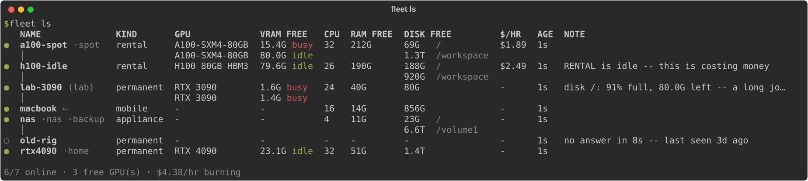
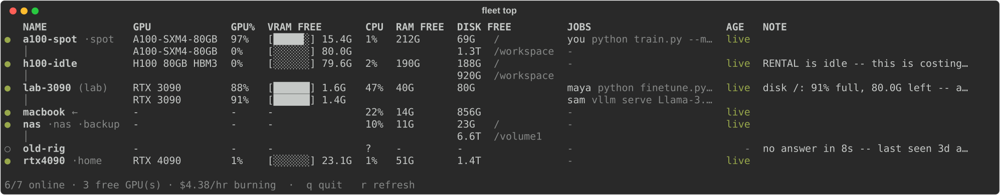

<!-- mcp-name: io.github.lion-zhang/fleet -->
<div align="center">

# fleet — let your coding agent use every machine you have

**Claude Code, Codex and Gemini see one machine: the one they run on.<br>
fleet shows them all of yours — every GPU and what is running on it, the models being
served, the software installed, and where your models and data live.**

No account, no cloud service, nothing installed on the machines you add, no keys handed
out: fleet logs in exactly as you do, with the SSH you already use.

[](https://github.com/lion-zhang/fleet/actions/workflows/test.yml)
[](LICENSE)




</div>

## The problem

Ask your agent to train a model and it starts on your laptop — while a 4090 sits idle
across the room and a rented A100 bills you by the hour. It cannot use what it cannot see.

- **Your agent is stuck on one machine.** It has no idea your other boxes exist.
- **Finding a free GPU is manual.** SSH into five hosts, run `nvidia-smi`, compare in your head.
- **It cannot see what is running, or what is already there** — whose job is on that card,
  which box already serves Llama 3, where the datasets live — so it downloads and
  installs things twice.

## Get started: ask your agent

Paste this into Claude Code, Codex, Gemini CLI, or any agent that can run commands, on
the machine you work from:

```text
Install fleet from https://github.com/lion-zhang/fleet
```

<sub>Agents: the steps are in [INSTALL.md](INSTALL.md).</sub>

That is the whole setup. fleet is installed once on this machine, and every
[supported agent](docs/guides/agents.md) you have here learns it — not only the one you asked.
From here on you say what you want in plain words, with no commands to remember.

### Then add your machines

Tell the agent how you reach a machine — the SSH command you already use is enough — or
let it look in your `~/.ssh/config` and on your tailnet for machines you can already reach:

> **You:** add my GPU server, `ssh ubuntu@10.0.0.7`
>
> **Agent:** Added as `gpu-box`: 2× RTX 4090, both idle, 46 GB free. It's ready to use.

Each one takes a sentence, whatever the machine is:

| The machine | What you tell the agent |
|---|---|
| a server you can already SSH into | "add `ssh ubuntu@10.0.0.7`" — fleet logs in as you do, with your key |
| one you reach with a particular key file | "add `ssh -i ~/.ssh/my_key ubuntu@1.2.3.4`" — or a `Host` from your `~/.ssh/config` |
| a machine on your tailnet | "find my machines" — it lists your ssh config hosts and tailnet machines, and adds the ones you pick |
| a new rental (vast.ai, RunPod, AutoDL) | "add `ssh -p 40001 root@1.2.3.4`, it costs $1.89/hr" — with the key on your provider account |
| one that only takes a password | "add it" — fleet offers `ssh-copy-id`, you type the password once into ssh, and your key goes on it |
| one that will not let you in | "why can't you reach the NAS?" — `fleet doctor` names the one thing to fix |

Nothing is installed on the machines you add: they only need SSH, on Linux, macOS or
Windows. fleet probes each one for its GPUs, memory and disks, and keeps that current.

### Then let the agent pick

You describe the work; the agent finds where it fits. It checks what each machine has
*and* what is free on it right now, so it will not send a job to a busy card:

> **You:** train `train.py` on whatever has a free 24 GB card
>
> **Agent:** `rtx4090` has 23.1 GB free and an idle GPU; `a100-spot` is free too but costs
> $1.89/hr. Starting on `rtx4090`, logging to `train.log`.

| You say | How the agent finds it |
|---|---|
| "what's free right now?" | every machine checked, the free ones listed |
| "find me a box with a 24 GB card" | matched by what machines have — NVIDIA, VRAM, cores, RAM — not by name |
| "run the tests on the Linux box" | the machine that runs Linux, results brought back |
| "what's costing me money?" | idle paid rentals flagged, with their hourly price |
| "who is using the GPUs?" | every job on every card — user, VRAM, how long, the command |
| "is Llama 3 already served somewhere?" | every model server's models, and the URL or ssh tunnel to reach it |
| "which box has torch 2.5 and CUDA 12?" | each machine's CUDA, Python environments and package versions |
| "download the dataset where datasets go" | the folder that machine says holds datasets, and the room left there |

Keys and passwords never go into the conversation, and anything irreversible waits for
your yes.

**Only install fleet where you use it.** The machines you add need nothing but SSH. Install
fleet on another machine only if you also run agents there; it works the same everywhere,
with nothing to join or sync. There, `fleet ls --discover` lists the machines in your ssh
config and on your tailnet; the ones you added by hand are in one file you can share with
your dotfiles.

### An app that cannot run commands?

Desktop apps and editors get fleet in one click; it runs as an MCP server:

| App | Install |
|---|---|
| **Claude Desktop** | open `fleet.mcpb` from the [latest release](https://github.com/lion-zhang/fleet/releases/latest) |
| **Cursor** | [](https://cursor.com/en/install-mcp?name=fleet&config=eyJjb21tYW5kIjoidXZ4IiwiYXJncyI6WyJhZ2VudHMtZmxlZXQiLCJtY3AiXX0%3D) |
| **VS Code** | [](https://insiders.vscode.dev/redirect/mcp/install?name=fleet&config=%7B%22command%22%3A%22uvx%22%2C%22args%22%3A%5B%22agents-fleet%22%2C%22mcp%22%5D%7D) |

Plus plugins for Claude Code, Codex, Copilot CLI and Gemini CLI, and OpenCode, Amp,
Windsurf, Cline, Zed, Qwen Code, Goose, Kiro, Hermes — 35+ agents in all:
**[every agent →](docs/guides/agents.md)**

## Built to be safe

- **Nothing to install on your machines.** fleet probes with one script over one SSH
  connection — Linux, macOS or Windows. A NAS or a fresh rental works as it is. The few
  files it does leave there are listed in
  [What fleet changes](docs/guides/what-fleet-changes.md).
- **No keys handed out, no access managed.** fleet connects exactly as you do — your ssh
  config, your keys and agent, Tailscale SSH, your rental provider's key — and writes no
  keys anywhere. Who may reach what stays where you already decide it. When a machine
  refuses, `fleet doctor` tells you the fix; fleet never makes it.
- **No passwords.** fleet never asks for one or stores one, and the agent never sees a
  credential. Secrets in a GPU job's command line are blanked before anyone sees them.
- **The agent asks, not guesses.** It is told to ask which machine you mean, to leave
  irreversible commands to you, and not to start work on a GPU someone else is using.
- **Nothing phones home.** Apart from installing and updating itself, fleet talks to your
  machines and nothing else: no account, no telemetry, no update check. Found a flaw? [SECURITY.md](SECURITY.md) says how to
  report it privately.

## Prefer the command line?

Everything the agent does is a plain `fleet` command. To install fleet yourself, run this
on the machine you work from (this is also what your agent runs when you ask it):

```bash
curl -LsSf https://raw.githubusercontent.com/lion-zhang/fleet/main/install.sh | sh
```

<sub>Windows: `powershell -ExecutionPolicy ByPass -c "irm https://raw.githubusercontent.com/lion-zhang/fleet/main/install.ps1 | iex"`</sub>

Then drive it yourself:

```bash
fleet ls                            # every machine, with what is free right now
fleet ls --tag cuda --tag vram-24g  # by capability: NVIDIA, a card of 24 GB or more
fleet top                           # live view, like htop for the whole fleet
fleet show gpu-box                  # one machine in detail: jobs, software, models, folders
fleet ps                            # every job on every GPU, and which GPUs are idle
fleet models                        # every model being served, and how to reach it
fleet edit gpu-box --path models=/data/models   # where that machine keeps its models
fleet ssh gpu-box -- nvidia-smi     # run something there
fleet add "ssh ubuntu@10.0.0.7"     # add a machine
fleet ls --discover                 # machines in your ssh config and on your tailnet
fleet doctor nas                    # why a machine will not let you in, and the fix
```






Where a machine keeps its models, datasets and media is written on the machine itself,
in `machine.yaml` (`fleet edit NAME --path models=/data/models`). Whoever looks at that
machine reads the same answer, and the folder sizes and free space come with every probe.

Rentals from vast.ai, RunPod or AutoDL show their price (`fleet edit a100 --cost 1.89`),
the fleet's burn rate, and an alert when a rental sits idle. On Tailscale, ZeroTier
or WireGuard? fleet just needs an address it can route to.

## How fleet compares

fleet is about the machines you already have. It complements tools that launch new ones.

| | `ssh` + `nvidia-smi` | nvitop / gpustat | SkyPilot / dstack | **fleet** |
|---|:---:|:---:|:---:|:---:|
| All your machines in one view | ✗ | ✗ one machine | ✓ the ones it manages | ✓ |
| Built for coding agents (skill / MCP) | ✗ | ✗ | partly | ✓ |
| Nothing installed on target machines | ✓ | ✗ | ✗ | ✓ |
| Jobs, served models, software, data folders | ✗ | jobs, one machine | ✗ | ✓ |
| Launches new cloud VMs | ✗ | ✗ | ✓ | ✗ |

**Why not just Tailscale, Ansible, or an `~/.ssh/config`?** Use them with fleet, not
instead of it. Tailscale connects your machines, and fleet runs over it happily, but it
does not tell your agent which machine has a free GPU. Ansible changes machines to match
a playbook you write, and has no idea what is busy right now. An `~/.ssh/config` names
your hosts, and fleet reads it. fleet is the part in between: what you have, what is
free on it, what is running and installed there, in a form your agent can use without
you.

## FAQ

**Setting up**

<details>
<summary><b>Do I need to install fleet on every machine?</b></summary>

No. Install it where you **use** it: the machine you work from, and any other machine
where you also run agents. The machines you only *use* — GPU servers, rentals, a NAS —
need SSH and nothing else.
</details>

<details>
<summary><b>Do I need Tailscale?</b></summary>

No. fleet uses whatever SSH reaches your machines: a LAN, a VPN, a jump host, a rental's
public port. If you have Tailscale, `fleet ls --discover` finds your tailnet machines
for you, and Tailscale SSH decides who may log in where — fleet just connects. See
[Reaching your machines](docs/guides/reaching-machines.md).
</details>

<details>
<summary><b>I run fleet on two machines. Do they share anything?</b></summary>

They do not need to: each one looks at the machines its own SSH reaches, and what a
machine says about itself — its cost, tags, where its models live — is kept on that
machine, so both read the same. The machines you added by hand are in one file,
`machines.yaml` (`fleet paths` shows where); copy it, or keep it in your dotfiles.
</details>

<details>
<summary><b>I use Claude Code <i>and</i> Codex (and more) on one machine. Does that work?</b></summary>

Yes — that is the normal case. fleet is installed once per machine: one command, one
list of machines. Each agent only gets a small skill or MCP entry pointing at
it, so Claude Code, Codex, Gemini CLI and a desktop app all see the same machines, and can
use them at the same time. Install a new agent later? Ask an agent that has fleet to run
`fleet setup`.
</details>

<details>
<summary><b>What does my agent actually get?</b></summary>

Agents that can run commands (Claude Code, Codex, Gemini CLI, Copilot CLI, OpenCode, …)
get a skill — text that tells them the `fleet` commands; it costs nothing until a task
needs a machine. Apps that cannot (Claude Desktop, Cursor, VS Code, …) get an MCP server
that runs the same commands for them. See [Agents](docs/guides/agents.md). After
installing, start a new session so the agent loads it.
</details>

**Safety**

<details>
<summary><b>Does fleet store my passwords? Does my agent see my keys?</b></summary>

No and no. fleet has no key of its own and never handles a password: it runs `ssh` as
you would. For a machine that only takes a password, it offers `ssh-copy-id` in your
terminal, where you type the password into ssh itself, once. The agent runs `fleet ssh
NAME` and never sees a key or a password; it may see a machine's address, as `fleet
show` prints it.
</details>

<details>
<summary><b>What does fleet leave on the machines I add?</b></summary>

Almost nothing: the notes file `fleet edit --path` writes there (`machine.yaml`), a
small cache of software versions and folder sizes in `~/.cache/fleet`, and nothing at
all in `authorized_keys`. No program, no service.
[What fleet changes](docs/guides/what-fleet-changes.md) has the full list.
</details>

<details>
<summary><b>Can the agent do something I cannot undo?</b></summary>

It is told not to. Removing a machine is left to you, and is not available to apps over
MCP at all. When a request is ambiguous — which machine, which user — the agent asks
instead of guessing.
</details>

**Machines**

<details>
<summary><b>The disk space fleet reports is wrong.</b></summary>

Some systems — containers, GPU rentals — show `/` as a small overlay while the space is on
another volume. Tell fleet which paths to watch: "on gpu-box, watch /workspace", or
`fleet edit gpu-box --disk-path /workspace`. See
[Disks](docs/guides/find-machines.md#disks-tell-fleet-where-the-space-is).
</details>

<details>
<summary><b>My rental came back on a new IP or port.</b></summary>

Re-point it, keeping its name, tags, cost and history: "gpu-box is now at
`ssh -p 40123 root@5.6.7.8`", or `fleet edit gpu-box --ssh "ssh -p 40123 root@5.6.7.8"`.
</details>

<details>
<summary><b>My machines are behind different NATs, or at different sites.</b></summary>

fleet does not solve connectivity; it uses the routes you have. The machine you run
fleet on must reach each machine over SSH; the machines never need to reach each other.
For machines behind different NATs, put them on a mesh network such as Tailscale or
ZeroTier and add them by their mesh address. See
[Reaching your machines](docs/guides/reaching-machines.md).
</details>

<details>
<summary><b>Windows?</b></summary>

Yes, both ways. A Windows machine works as a target with OpenSSH Server and nothing
else, and fleet runs on Windows too. See [Windows](docs/guides/windows.md).
</details>

<details>
<summary><b>Does anything keep running in the background?</b></summary>

No. fleet runs only when you or an agent use it. On a machine it looks at, a `du` of the
folders you named may run in the background now and then, so their sizes are known
without making a probe wait.
</details>

<details>
<summary><b>I used fleet 0.5. What changed?</b></summary>

fleet stopped managing access: no center, no invites, no keys of its own. Upgrade, and
add your machines again. [Upgrading from 0.5](docs/guides/upgrading-from-0.5.md) lists
what 0.5 left on your machines and how to remove it.
</details>

<details>
<summary><b>How do I remove fleet?</b></summary>

`fleet uninstall` (`--purge` to delete its files too): it removes fleet from your agents
and prints the last step, `uv tool uninstall agents-fleet`. See
[Removing fleet](docs/guides/install.md#removing-fleet).
</details>

## Learn more

- [Getting started](docs/getting-started.md) — your first fleet, in ten minutes
- [Guides](docs/README.md#guides) — adding machines, reaching them, what is on each one, Windows
- [Every agent](docs/guides/agents.md) — install commands and config for 35+ agents
- [Command reference](docs/reference/cli.md) — every command and option
- [How fleet works](docs/design/how-it-works.md) — what happens, step by step, under the hood
- [Design](docs/design/layers.md) — one core per machine, a skill per agent, MCP for the rest
- [All documentation](docs/README.md)

**Status:** v0.6. The test suite runs on Linux, macOS and Windows, and every command is
run end to end on a real machine of each OS in CI — from a script, as an agent runs it,
and at a real terminal, as you do.

Issues and pull requests are welcome — see [CONTRIBUTING.md](CONTRIBUTING.md). If fleet saved
you a GPU-hour, a ⭐ helps other people find it.

[MIT](LICENSE)
