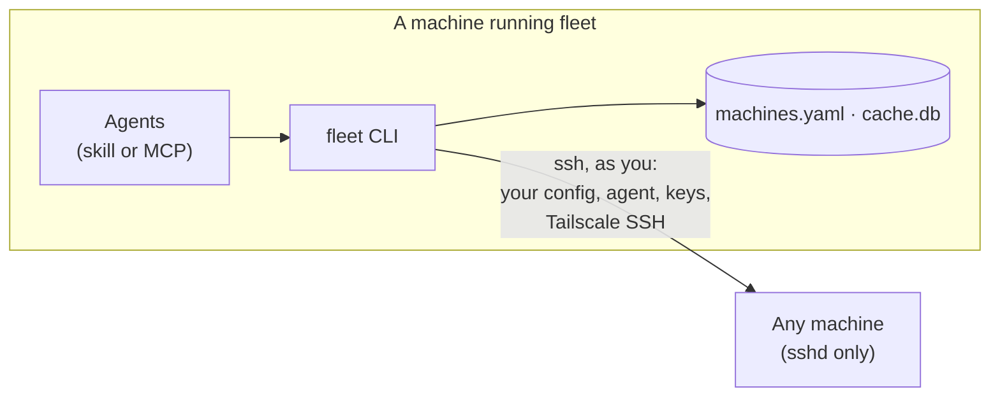

# How fleet works

This page follows fleet through what it does — from installing to running a job — and
names the parts involved at each step.

The short version: fleet is a viewer of what your own ssh reaches. Each machine running
fleet keeps a list of the machines you added there, measures them over ssh when asked,
and shows the result to you and your agents. It manages no access, keeps no keys, runs
nothing in the background, and talks to no other fleet.

## The parts

| Part | What it is |
|---|---|
| **The `fleet` CLI** | Everything fleet does is a `fleet` command. Installed once per machine, shared by every agent on it. ([why](layers.md)) |
| **Skill** | Text written into each agent's skill folder by `fleet setup`, telling it which command to use for what. No code. |
| **MCP server** | `fleet mcp`, launched by apps that cannot run commands. Each tool runs one `fleet` command and returns its output. |
| **The list of machines** | `machines.yaml` in fleet's configuration folder: the machines you added on this machine, their ssh commands, names, tags and cost. Written only here, copied nowhere. |
| **Readings** | `cache.db`: the latest measurements. Disposable. |
| **`machine.yaml`** | On each machine, about itself: where it keeps models and data, its tags, cost and notes. Read by every fleet that probes it. ([more](../guides/resources.md#machineyaml)) |
| **`ssh`** | The one you already use. fleet runs it; it never replaces it, and it brings no key of its own. |

Two machines that both run fleet do not know about each other. Each looks at the machines
*its* ssh reaches. That is why there is nothing to sync and no machine that has to be
online for the others to work.

## Installing

The installer gets [uv](https://docs.astral.sh/uv) if it is missing, and installs the
`agents-fleet` package with it — unless some copy of fleet is already on the machine, in
which case it keeps that one. Then it runs `fleet setup`, which teaches each agent
installed here: it looks for the agents it knows by their folders, writes the skill where
each one reads skills — `~/.claude/skills`, the shared `~/.agents/skills`, Hermes' own —
and registers the MCP server in the config of apps without a shell. It leaves everything
else in those files alone. Each skill is stamped with a hash of its text, so `fleet ls`
can tell when an agent is reading an older one.

There are no modes to choose: every machine is installed the same way.

## The first run

Not everyone arrives through the installer: `uv tool install`, pipx, a plugin, or an MCP
client launching `fleet mcp` all skip it. So the first `fleet ls`, `show`, `top`, `add`
or `setup` on a machine does the same, once: it records the machine itself in
`machines.yaml` (measured locally, with no ssh) and runs `fleet setup` for the agents it
finds. It says so in one line, and leaves a marker in fleet's state folder so it never
happens again. `FLEET_NO_FIRST_RUN=1` skips it.

## Adding a machine

`fleet add "ssh ubuntu@10.0.0.7"`:

1. **The ssh command is parsed** the way ssh would read it: `-p`, `-i`, `-J`, and the
   matching `Host` in `~/.ssh/config` with its user, port, key and `ProxyJump`. A bare
   name from `fleet ls --discover` stands for the ssh command listed for it.
2. **The machine is measured** over that connection, in batch mode: ssh offers whatever
   your agent and config would, and never prompts for a password.
3. **If it refuses or does not answer, nothing is recorded.** fleet works out why —
   the same diagnosis `fleet doctor` gives — and prints the reason and the fix. At a
   terminal on Linux or macOS, a refused key is met with an offer to run `ssh-copy-id`,
   after which fleet tries again ([details](../guides/reaching-machines.md#putting-your-key-on-it-from-here)).
4. **If it answers, the record is written** to `machines.yaml`, through the
   [write queue](#several-agents-at-once). A machine already known — the same
   machine-id at another address — gains the address and keeps its name.

Nothing is written on the machine. fleet puts no key there and installs nothing.

## Finding machines to add

`fleet ls --discover` reads two places that already say which machines you use: the
`Host` entries of `~/.ssh/config` (following `Include`), and `tailscale status --json`
when Tailscale is running here. It lists what it finds, marks what is already added, and
contacts none of it. `fleet add NAME` adds one.

## Measuring

Every reading is one script, piped over one SSH connection: `payload.sh` on Linux and
macOS, `payload.ps1` on Windows — fleet notices which from the first answer. The script
prints sections (host, CPU, memory, GPUs from `nvidia-smi` or `amd-smi`, disks, processes, listening
ports, model servers, software, the machine's own `machine.yaml`), and fleet parses them
into a reading in `cache.db`. Nothing is installed. On Linux and macOS the script runs
from a temporary file, removed when it finishes, and keeps two slow answers — folder
sizes from `du`, and the software list — in `~/.cache/fleet` on the machine, refreshed
every six hours ([details](../guides/what-fleet-changes.md)).

The machine fleet runs on is measured directly, without ssh.

`fleet ls` measures every machine whose last reading is older than a minute, up to eight
at a time, and reuses the rest. A machine that keeps not answering is asked less and less
often — the wait doubles, up to half an hour — so a switched-off box never makes
`fleet ls` slow. Naming a machine skips that wait, though a reading under a minute old
is still reused; `-r` always measures again. On Linux and macOS, connections to
the same machine are shared for two minutes, so a burst of commands pays for one SSH
handshake.

What is shown is computed from the reading each time: free VRAM, whether a GPU is busy,
the [facts](../reference/facts.md) (`cuda`, `vram-24g`, …) and the alerts. Nothing derived
is stored, so nothing derived can go stale.

A probe that fails says how: `auth_failed` (the machine is up and refused us),
`timeout`, `refused`, `host_key_mismatch` and so on. An agent must never confuse "the box
is down" with "it will not let me in", so the status is never a yes or no.

## When a machine refuses

`fleet doctor NAME` connects once more, with ssh's verbose output, and reads what the
server says it is — OpenSSH, Windows' OpenSSH, Tailscale — and why it said no. From that
and the last reading (the OS, signs of a rental provider) it picks the one fix: your key
line for that OS, the provider's account page, a Tailscale SSH policy rule, starting
sshd, or clearing a changed host key. It applies none of them. `src/fleet/ops/doctor.py`
holds the whole decision.

## Finding and using a machine

The agent's skill tells it to pick machines by what they have, not by name:
`fleet ls --tag cuda --tag vram-24g --json` returns only machines whose facts or tags
match, with what is free on each. It reads the alerts as blocking — a GPU with memory held
by processes fleet cannot see is not free.

`fleet ssh NAME -- COMMAND` then looks the machine up, picks its preferred address, and
runs `ssh` with the user, port, `-i` key and jump host recorded for it — and otherwise
whatever your ssh config says. It replaces itself with that `ssh`, so the terminal, the
exit code and Ctrl+C all belong to the remote command; on Windows it waits for `ssh`
instead. The agent needs only the name: no address, key or password passes through it.

## Several agents at once

Claude Code, Codex and a desktop app on one machine all run the same `fleet` against the
same files, possibly at the same moment. Two rules keep that safe:

- **Reads never wait.** A state file is only ever replaced whole: written to a unique
  temporary file, then renamed over the old one. A reader sees the old file or the new
  one, never half of either.
- **Writes take turns, and apply to the file as it is now.** A write is a small change —
  add a machine, tag a box, rename one. The process takes a numbered ticket (a file
  created atomically), waits only for the tickets before it, reloads the file, applies
  its change, and saves. Nobody saves a copy loaded earlier, so two agents' changes never
  overwrite each other. Network work — measuring a machine — happens before the turn, so
  a slow machine never holds up anyone else.

`machine.yaml` on a machine can be written by several people from several places. There
fleet writes only if the file is still what it read, and otherwise reads it again.

## Where to look in the code

| What | Where |
|---|---|
| every command | `src/fleet/cli.py` |
| adding a machine, naming it | `src/fleet/onboard.py` |
| discovery, the doctor, the first run, `machine.yaml` | `src/fleet/ops/` |
| the list of machines, write queue, readings | `src/fleet/state/` |
| building `ssh` commands; your key and the lines that install it | `src/fleet/ssh/` |
| the measuring scripts and their parser | `src/fleet/probe/` |
| facts, alerts and what `ls` shows | `src/fleet/render/view.py` |
| skill text and where each agent reads it | `src/fleet/agents/` |
| the MCP server | `src/fleet/mcpserver.py` |
| installing and updating fleet on other machines | `src/fleet/install.py` |
