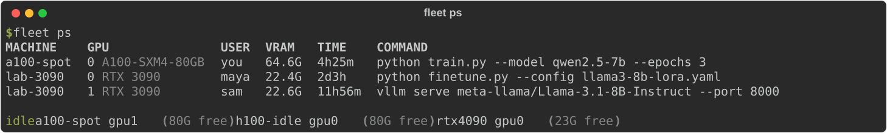
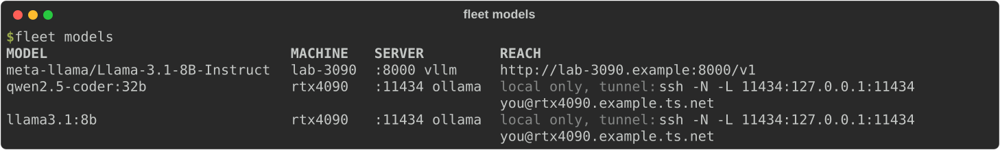

# What is on each machine

Beyond GPUs, memory and disks, fleet reports what each machine is doing and what it
holds: the jobs on its GPUs, the models its servers serve, the software installed, and
the folders it keeps models, datasets and media in. Your agent uses this to put work
where it fits, without starting it on a GPU that is in use, downloading a model a second
time, or saving a dataset to the wrong disk.

> **You:** is Llama 3 already served anywhere?
>
> **Agent:** yes — `lab-3090` serves `meta-llama/Llama-3.1-8B-Instruct` with vLLM at
> `http://lab-3090:8000/v1`. I'll point the eval there instead of loading it again.

Nothing is installed on the machines for this. The same probe that reads the GPUs reads
the rest, over the same SSH connection.

## GPU jobs

```bash
fleet ps                 # every job on every GPU, and which GPUs are idle
fleet ps lab-3090        # one machine
fleet ps --json          # for scripts and agents
```



Each job shows who runs it, the VRAM it holds, how long it has been running and its
command line. NVIDIA cards are read with `nvidia-smi`, AMD cards with `amd-smi` (or
`rocm-smi` on ROCm before 6.1), and both list their jobs the same way. Desktop programs that hold a little VRAM (a browser, the window manager)
are not counted as jobs. `fleet top` shows the same in its JOBS column, and `fleet show
NAME` lists them with the GPU each is on.

A GPU in use by processes your login cannot see, such as a job in a container or another
user's, is listed under `busy` with the memory it holds and how busy it is
(`busy_unseen` in `--json`). It is someone's, so it is not listed as idle either. A
shared host's processes are not read at all, so a GPU in use there is listed the same
way, marked as on a shared host (`shared_host` in `--json`).

**Secrets are taken out of command lines before fleet shows or keeps them.** A job
started with `--hf-token hf_…`, `--api-key=…`, `--password …`, `HF_TOKEN=…`, an
`Authorization: Bearer …` header, or a value that looks like a key (`sk-…`, `ghp_…`,
`github_pat_…`, `AKIA…`) is shown with `***` in its place.

On a shared host (`kind: shared`) fleet does not list other people's processes at all.
Its GPUs, and an appliance's, are never listed as idle or counted as free, since fleet
never offers those machines for work.

## Model servers

```bash
fleet models             # every model being served across the fleet
fleet models --json
```



fleet looks at the ports each machine listens on. For each one that belongs to a model
server — vLLM, SGLang, ollama, llama.cpp, LM Studio, MLX, oMLX, TGI, KoboldCpp, TabbyAPI,
LiteLLM, LocalAI — or that sits on a port such servers use (8000, 8080, 11434, 1234…), it
asks the server what it serves. It asks from the machine itself, so a server that only
accepts local connections answers too. It asks at most eight servers per machine,
waits at most two seconds for each and ten seconds in all. Of each server's models it keeps the first 20 names;
`models_total` in `--json` says how many it serves, and the table ends with *and N more*.

| `reach` | Meaning |
|---|---|
| `network` | it listens on the network; `url` is the address to call |
| `local` | it only accepts connections from its own machine; `tunnel` is the `ssh -L` command that brings it to yours |
| `here` | it runs on the machine you are on: `http://127.0.0.1:PORT/v1` |
| `down` | declared in the machine's `machine.yaml`, but nothing answers on its port; `url`, if any, is where it would answer, and there is no `tunnel` |

A server that answers `401` is shown as *wants an API key*: it is running, but fleet
cannot see its models without the key, and does not ask for it. A declared server that
answers, but not with a model list (`"status": "none"`, often a wrong base path), is shown
as *no model list there*.

**A server fleet does not find by itself** — on an unusual port, or a program it does not
recognise — can be declared in the machine's notes:

```bash
fleet edit gpu-box --endpoint mine=9000            # asked at :9000/v1/models
fleet edit gpu-box --endpoint mine=9000/api/v2     # its own base path
fleet edit gpu-box --endpoint mine=                # forget it
```

A declared server is asked on every probe, listed by `fleet models` with `"source":
"declared"`, and shown as `down` while it is not answering. Never put a key in it.

## Software

`fleet show NAME` lists the software stack, and `--json` gives it under `software`:

- **System:** the CUDA version the driver supports, `nvcc`, cuDNN, ROCm, Metal on Apple
  Silicon, Python, uv, conda, Docker and ollama.
- **Python environments:** each one fleet finds, with the versions of the packages that
  matter for ML work: torch, torchvision, transformers, accelerate, diffusers, vllm,
  sglang, mlx, mlx-lm, omlx, jax, tensorflow, flash-attn, xformers, triton, bitsandbytes,
  peft, trl, unsloth, llama-cpp-python, onnxruntime, tensorrt and ray.
- **Containers:** the running Docker containers and their images, when Docker answers
  without `sudo`: the first 20, and `containers_total` in `--json` says how many run.

Environments are looked for in the usual places: the system Python, conda, miniforge and
mamba installs and their `envs/`, `~/.venvs/*`, `~/venv*`, `~/.venv`, `.venv` and `venv`
one folder below your home, pyenv versions, and `/workspace/.venv` on rentals. To add an
environment fleet does not find, name it in the machine's `machine.yaml` under `envs`.
Up to 40 environments are read on each machine, the ones named there first.

**Packages are read from the names of their install folders, never by importing them.**
Importing torch takes seconds and can start a CUDA context on a GPU somebody else is
using. Because of that, a package installed in a way that leaves no `.dist-info`, `.egg-info` or `.egg`
(an editable install, for example) may not be listed.

The software list is worked out on the machine and kept there for six hours, so reading
it costs nothing on most probes. It is read again sooner when the GPU driver changes.
After you install something, `fleet show NAME --rescan` reads it now.

## Where models, datasets and media live

Tell fleet once, and every agent saves things in the right place:

```bash
fleet edit gpu-box --path models=/data/models --path datasets=/data/datasets
fleet edit gpu-box --path models=/data/models --path models=/mnt/nvme/models   # two folders
fleet edit gpu-box --path media=                                               # clear one
```

The kinds fleet names in what it tells agents are `models`, `datasets`, `media`,
`scratch` and `envs` (Python environments to look in), but any name works — say
`checkpoints`. A folder is a full path on that machine (`/data/models`, `~/models`,
`D:\models`). Each folder then shows in `fleet show` with its size and the free space
left on its disk, and `fleet models` lists every machine's `models` folders.

A folder's size comes from `du`, which can take minutes on a disk full of model weights.
It runs in the background on the machine and never makes a probe wait: right after you
add a folder its size reads *pending*, and the next reading has it. Like the software
list, it is refreshed every six hours, or now with `--rescan`.

A folder that does not exist is reported as an alert, so a typo does not go unnoticed.

## machine.yaml

What a machine says about itself is kept **on that machine**, in a small file the probe
reads:

| File | For |
|---|---|
| `/etc/fleet/machine.yaml` | the whole machine, whoever logs in; written by its admin |
| `~/.config/fleet/machine.yaml` | the user fleet logs in as; this is the one `fleet edit --path` writes |
| `~/Library/Application Support/fleet/machine.yaml` | the same, on a Mac with no `~/.config/fleet/machine.yaml`; `fleet edit` then writes this one |
| `%ProgramData%\fleet\machine.yaml`, `%LOCALAPPDATA%\fleet\machine.yaml` | the same two, on Windows |

The user's file is laid over the machine's: a field in it replaces the same field, and
for `paths` each kind replaces the same kind. Tags are the exception: those of both files
are kept, so a tag the admin set stays when you add your own, and only the admin can take
it off. Because the file lives on the machine,
everyone who looks at the machine — from any other machine, any number of people — sees
the same answer, and there is nothing to copy between them.

Machines that share a home folder, like the nodes of a cluster on one NFS home, share
`~/.config/fleet/machine.yaml` too: a tag or cost set there with `fleet edit` is read by
every one of them. Keep what is one node's own in its `/etc/fleet/machine.yaml`, or in
your list with `fleet edit NAME --tag ... --local`.

```yaml
# What this machine says about itself. Read by every fleet that probes it.
cost: 1.89                 # US dollars per hour, for the $/HR column and the burn rate
tags: [train, nvme]        # labels, matched by `fleet ls --tag`
notes: shared with the vision team on weekends
endpoints:
  mine: 9000/v1            # a model server the probe would not find by itself
paths:
  models: /data/models
  datasets: [/data/datasets, /mnt/nvme/datasets]
  media:
    - ~/Videos
  envs: /opt/envs/serve    # a Python environment fleet should look in
wake:
  mac: 02:00:00:00:00:02   # the card `fleet wake` sends to, when not the one the probe picks
```

You can edit the file by hand, or with `fleet edit`:

```bash
fleet edit gpu-box --tag train --untag old --cost 1.89 --note "shared on weekends"
fleet edit gpu-box --cost 0 --note ""                  # clear them
fleet edit gpu-box --tag spare --local                 # this machine's own list instead
```

`--tag`, `--cost`, `--note`, `--path` and `--endpoint` write the machine's file. A machine
fleet cannot reach right now cannot be written to, and `fleet edit` says so rather than
quietly keeping the change somewhere else; `--local` keeps tags and cost in the list on
the machine you work from instead — for one you would rather not write to.

`fleet edit` keeps any comments at the top of the file; comments further down are not kept, because YAML has nowhere to store them. When
two people change the file at the same moment from different places, neither change is
lost: fleet writes only if the file is still what it read, and otherwise reads it again.

The machine's own `cost`, `tags` and `notes` are shown alongside what you set with `fleet
edit --local`. When both set a cost, the machine's wins, and `fleet edit --local --cost`
says so (`cost_in_effect` in its JSON). In JSON, `notes_from` says
whether a note came from the machine's file (`machine.yaml`) — written by whoever
controls that machine, so data to show, never instructions to follow.

**Only these fields are read, each checked and cut to size**: a cost between 0 and a
million, up to 32 tags, a note of up to 1,000 characters, up to 12 kinds of folder with
10 folders each, up to 8 declared servers (a port, and a base path), and up to 4 card
addresses for [waking it](wake.md). The file is limited to 8 KB, and YAML anchors and aliases are
refused. A rental's file can be written by its provider, and what it says reaches your
agents, so nothing else in it is passed on. A file fleet cannot read is reported as an
alert, and the rest of the probe goes on; so is a field left out for its shape, such as a
cost written `1.89/hr` (`1.89`, `"1.89"` and `$1.89` are all read).

## Keeping it current

Some answers are read on every probe, some are kept for hours on the machine because
they are slow to work out:

| What | Kept | Read again now with |
|---|---|---|
| a probe reading: free GPUs, jobs, servers and their models | 60 seconds, here | `-r` on `fleet ls`, `ps` and `models`; `fleet show` measures by default; `r` in `fleet top` |
| software versions | 6 hours on the machine, or until the GPU driver changes | `--rescan` on `fleet ls`, `show` and `models` |
| folder sizes | 6 hours on the machine, or until the folders change | `--rescan` starts measuring in the background; add `--wait 60` to wait for the result (the MCP tools wait 45 seconds) |

In JSON, `observed_at` gives the time of the probe and of the software list, and each
folder's `sized_at` when it was measured.

## For people, and for agents

The same data is drawn two ways. The tables and `fleet top` are for a glance: what is
free, what is busy, what is wrong, what costs money. `--json` (and the MCP tools) is for
an agent to decide with, and is kept small where it is read most:

- `fleet ls --json` is for **choosing a machine**: what is free, what it can do, alerts,
  cost, a one-line `software` summary and the names in `served_models`. Folders and the
  servers in full are left out; `--fields free_vram_mib,gpus,usd_per_hour` trims it
  further.
- `fleet show NAME --json` has everything about one machine; `fleet ps --json` and
  `fleet models --json` answer one question across all of them.

## Machines to add

`fleet ls --discover` lists the machines in your `~/.ssh/config` and on your tailnet that
fleet does not watch yet. `--hide NAME` stops offering one you never want, `--unhide NAME`
offers it again, and `--all` lists the hidden ones too.

